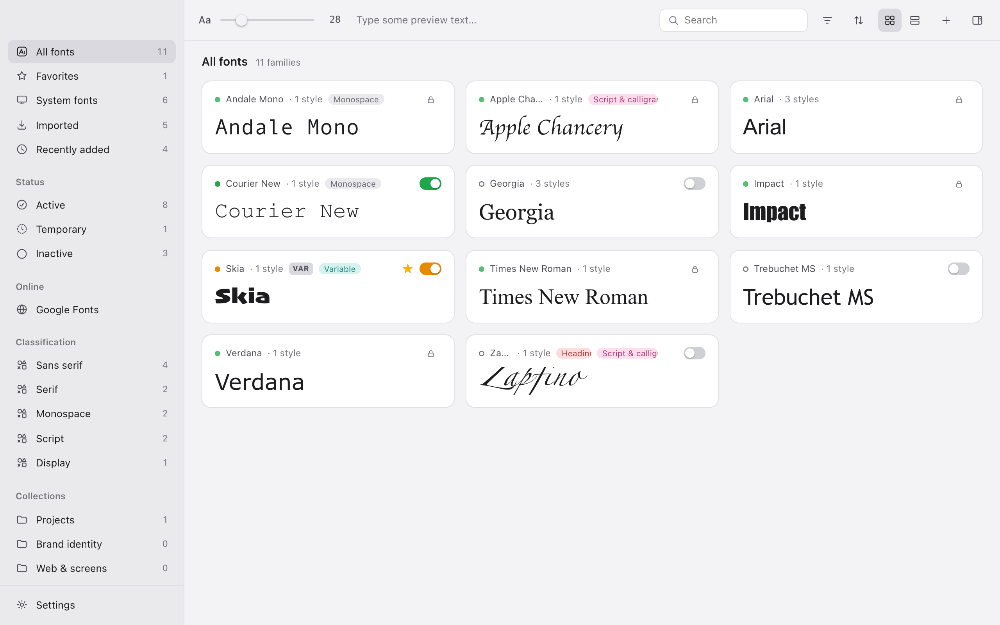
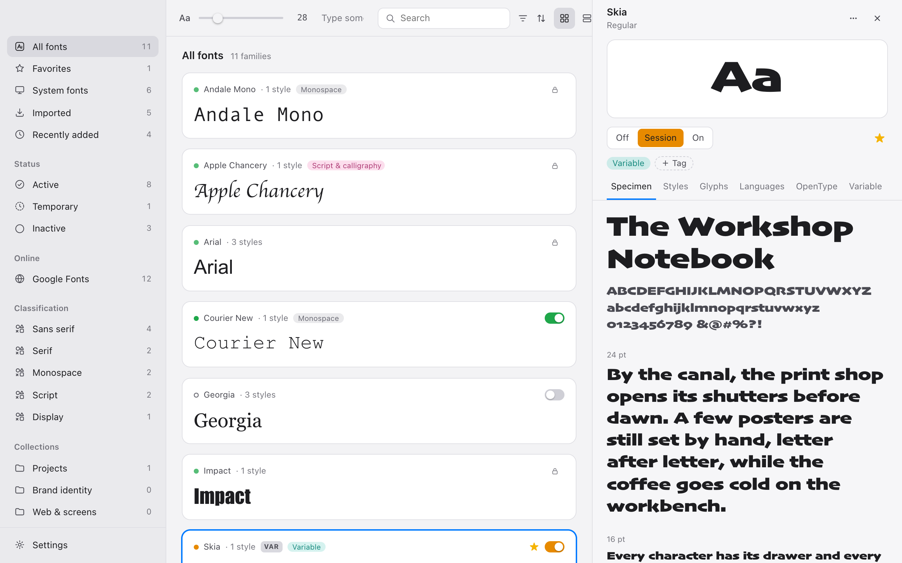
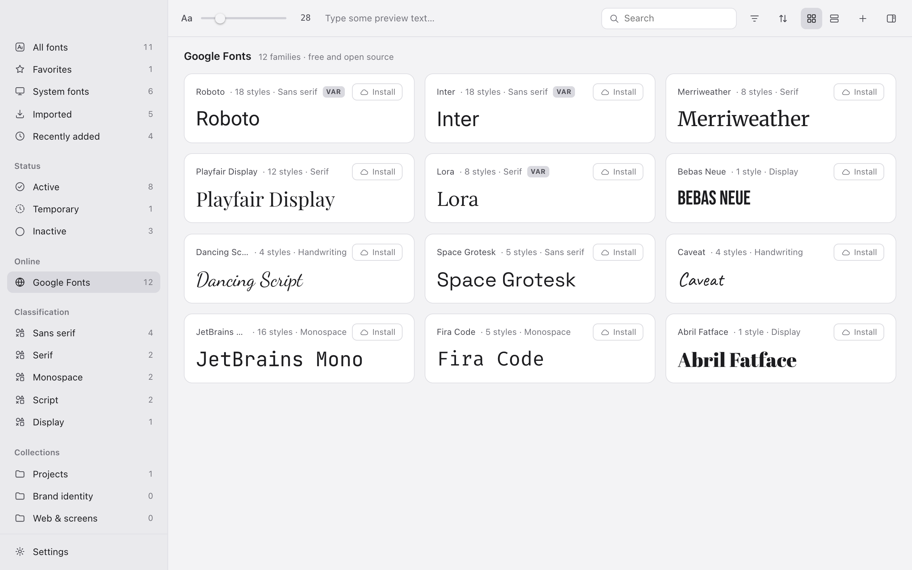
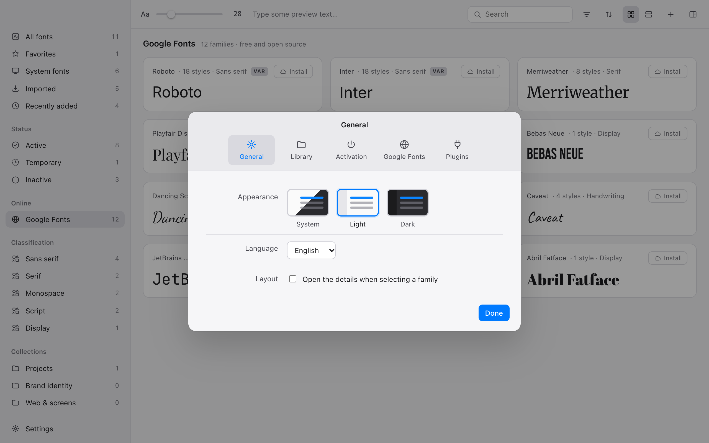

# Typeshelf

A cross-platform font manager (macOS, Windows, Linux) built with Tauri 2. Everything runs locally, with no account and no telemetry.

## Screenshots

Typeshelf follows the light or dark appearance you pick in Settings.

<picture><source media="(prefers-color-scheme: dark)" srcset="docs/screenshots/library-dark.png"></picture>
<picture><source media="(prefers-color-scheme: dark)" srcset="docs/screenshots/details-dark.png"></picture>
<picture><source media="(prefers-color-scheme: dark)" srcset="docs/screenshots/google-fonts-dark.png"></picture>
<picture><source media="(prefers-color-scheme: dark)" srcset="docs/screenshots/settings-dark.png"></picture>

## Features

- **Library**: import files or folders (`.ttf`, `.otf`, `.ttc`, `.otc`) with the button or by drag and drop. Duplicates are detected by PostScript name, and fonts can optionally be copied into the library.
- **Activation**: permanent, or temporary (until the app quits), per family or per collection.
- **Preview**: every family shown with an adjustable text and size, search, and automatic classification (sans serif, serif, slab, mono, script, display, symbols).
- **System fonts**: every font installed on the OS (system and user folders) appears in "All fonts" and stays active. Favoriting, tagging or filing one in a collection records it in the library by reference, and the file does not move.
- **Google Fonts**: the public catalog (about 1,900 open families) in the "Online" section, with live previews, filters by category, variable and italic, search by name or designer, and sorting by popularity. "Install" downloads every style as TrueType into the library (`Google Fonts` folder) and activates it, so it then works offline like any other font. The catalog is cached for a week, and Chinese, Japanese and Korean fonts are hidden by default (Settings › Google Fonts). No key or account is needed, and previews are loaded from Google's servers.
- **Adobe and Sketch plugins**: a Typeshelf panel for Photoshop (UXP), Illustrator and After Effects (CEP), and a Sketch plugin, list the fonts of the document and activate the missing ones as soon as it opens (library first, then Google Fonts). Settings › Plugins installs, updates and removes them in one click (macOS and Windows). They talk to a local API (127.0.0.1:47391, closed to web pages) that can be turned off in the same place. Details: [plugins/README.md](plugins/README.md).
- **Filters and sorting**: state (active, temporary, inactive), source (system, imported), classification, variable, monospace, italic; sort by name, date added or number of styles.
- **Grid or table**: the table shows the format and the date, and expands family by family.
- **Details**: specimen (several sizes, on a light or colored background), styles and size cascade, glyphs by category with search (character or U+XXXX), supported languages (26, checked against the cmap table), OpenType features you can toggle, sliders for variable axes, and file information.
- **Collections and favorites**: drag a family onto a collection, or right-click. A first launch offers collections and tags you can delete: Projects, Brand identity, Web & screens, To try, plus the smart tags Variable, Monospace and Script & calligraphy.
- **Color tags**: manual ones (drag a family onto the tag, right-click, or "＋ Tag" in the details) and smart ones that fill themselves from rules (family, style, designer, foundry, classification, weight, glyph count, italic, monospace, variable, favorite, active, date added), combined with "all" or "at least one". All the fonts of a tag can be activated at once.
- **Languages**: English and French. Typeshelf follows the system language, or the one chosen in Settings › General.

## Development

Requirements: Node 20+, Rust stable, and the [Tauri prerequisites](https://tauri.app/start/prerequisites/) for your OS.

```bash
npm install
npm run tauri dev
```

`npm run dev` alone opens the interface in a regular browser with demo data (`src/dev/mock.ts`, fonts that ship with macOS). That mode is never included in a build.

## Build

```bash
npm run tauri build
```

## Tests

```bash
cd src-tauri && cargo test
```

The end-to-end test (import, deduplication, real activation, collections, tags) runs when `TYPESHELF_TEST_FONTS` points to a folder holding at least one variable font, one `.ttc` collection and `Feather.ttf` (a font not installed on the system):

```bash
TYPESHELF_TEST_FONTS=/path/to/fonts cargo test
```

To regenerate the screenshots from the demo data, run `npm run dev` in one terminal and `npm run screenshots` in another (it needs Google Chrome).

Every interface string needs a French entry in `src/locales/fr.ts`. Check it with:

```bash
npm run i18n:check
```

## Activation per OS

| OS | Permanent | Temporary |
|---|---|---|
| macOS | CoreText, user scope | CoreText, session scope, removed on quit |
| Windows | `AddFontResourceEx` + a value in `HKCU\…\Fonts` (Windows 10 1809+) | `AddFontResourceEx` only, removed on quit |
| Linux | link in `~/.local/share/fonts/typeshelf` + `fc-cache` | link in `…/fonts/typeshelf-temporary`, deleted on quit |

The Windows and Linux modules are checked at compile time, and have not been tested on those systems yet.

## Data

The SQLite library and copied fonts live in the app's data folder (`~/Library/Application Support/dev.typeshelf.app` on macOS). The Google Fonts catalog is cached there (`google-fonts.json`).

## Contributing

See [CONTRIBUTING.md](CONTRIBUTING.md). To report a vulnerability, see [SECURITY.md](SECURITY.md).

## License

[MIT](LICENSE).
